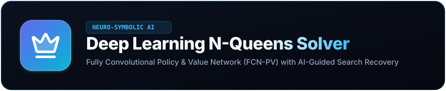

<p align="center">
  
</p>

<h1 align="center">Deep Learning N-Queens Solver &amp; Visualizer</h1>

<p align="center">
  <strong>An Intelligent Neuro-Symbolic Search Engine combining Fully Convolutional Policy &amp; Value Networks (FCN-PV) with Deterministic Constraint Verification and AI-Guided Recovery.</strong>
</p>

<p align="center">
  <a href="https://www.python.org/"></a>
  <a href="https://pytorch.org/"></a>
  <a href="https://fastapi.tiangolo.com/"></a>
  <a href="https://react.dev/"></a>
  <a href="https://vitejs.dev/"></a>
  <a href="LICENSE"></a>
</p>

---

<p align="center">
  
</p>

---

## 📑 Table of Contents

- [Overview](#-overview)
- [Key Features](#-key-features)
- [How It Works (High-Level)](#-how-it-works-high-level)
- [Architecture & Tech Stack](#-architecture--tech-stack)
- [Repository Structure](#-repository-structure)
- [Quickstart Guide](#-quickstart-guide)
  - [Prerequisites](#prerequisites)
  - [1. Clone Repository](#1-clone-repository)
  - [2. Backend Setup](#2-backend-setup)
  - [3. Frontend Setup](#3-frontend-setup)
  - [4. Single-Port Production Mode](#4-single-port-production-mode-optional)
- [Training & Model Development](#-training--model-development)
  - [Supervised Learning (FCN-PV)](#supervised-learning-fcn-pv)
  - [Reinforcement Learning (REINFORCE)](#reinforcement-learning-reinforce)
- [Benchmarking & Research Experiments](#-benchmarking--research-experiments)
- [REST API Reference](#-rest-api-reference)
- [In-Depth System Documentation](#-in-depth-system-documentation)
- [License](#-license)

---

## 🌟 Overview

The **$N$-Queens Puzzle** requires placing $N$ non-attacking queens on an $N \times N$ chessboard such that no two queens share the same row, column, or diagonal. For larger boards, the search space grows factorially ($\mathcal{O}(N!)$), rendering naive brute-force infeasible.

This project implements a **Hybrid Neuro-Symbolic Search Engine**:
1. **Neural Policy Network (The Intuition)**: A custom Fully Convolutional Network evaluates the spatial board tensor and outputs a probability distribution over the most promising squares.
2. **Deterministic Constraint Shield (The Rules)**: Standard chess rules strictly validate every neural proposal, preventing illegal placements.
3. **AI-Guided Search Recovery (The Backtracker)**: When dead ends occur, the system backtracks systematically and explores the model's next-best ranked choices, logging exact reasons for every rejected move.

---

## ✨ Key Features

- **🎮 Interactive Board & Custom First Move**: Click on *any* square on the board to place the first queen, and watch the AI solve the remaining board dynamically from your starting point.
- **🔍 Good vs. Bad Moves Audit**:
  - **Good Moves**: Confirmed valid queen placements, user starting moves, and complete solutions.
  - **Bad Moves**: Transparently logs neural mispredictions, row/column/diagonal conflicts with attacking queen coordinates, and lookahead dead ends.
- **🔥 Real-time AI Reasoning & Heatmaps**: Visualizes the neural network's spatial probability distribution across all squares and provides real-time solvability confidence scores ($V(s) \in [0, 1]$).
- **📐 Variable Board Sizes ($N \in [4, 16]$)**: Due to its fully convolutional dilated architecture, a single trained network seamlessly handles arbitrary board sizes without dimension mismatches.
- **🔄 Dual AI Engines**:
  - **Supervised Learning (SL)**: Trained on exact solution prefix trajectories augmented with chessboard $D_4$ dihedral symmetries.
  - **Reinforcement Learning (RL)**: Policy-gradient agent (REINFORCE with moving average baseline) trained with reward shaping.
- **⏱️ Playback Control**: Slow, Normal, Fast, and Instant playback with step-by-step forward navigation and interactive move inspection.
- **📊 Scientific Benchmarking Suite**: Head-to-head empirical comparison between traditional chronological backtracking and the deep learning solver (nodes explored, search depth, wall-clock time).

---

## 🧠 How It Works (High-Level)

```
                       ┌──────────────────────────────┐
                       │  User Places Initial Queen   │
                       └──────────────┬───────────────┘
                                      │
                                      ▼
                       ┌──────────────────────────────┐
                       │   3-Channel Board Tensor     │
                       │ [Occupancy, Threats, Mask]   │
                       └──────────────┬───────────────┘
                                      │
                                      ▼
                       ┌──────────────────────────────┐
                       │   FCN-PV Neural Network      │
                       │  - Spatial Policy Head P(a|s)│
                       │  - Solvability Value V(s)    │
                       └──────────────┬───────────────┘
                                      │
                                      ▼
                       ┌──────────────────────────────┐
                       │   Deterministic Validator    │
                       │  (Row, Col, Diagonal Check)  │
                       └──────────────┬───────────────┘
                                      │
                    ┌─────────────────┴─────────────────┐
                    ▼                                   ▼
          [Conflict Detected]                    [Move is Safe]
          - Log as BAD MOVE                      - Log as GOOD MOVE
          - Highlight attacking queen            - Place queen on board
          - Suppress candidate & pick next       - Check for dead ends / solve
```

For the complete mathematical formulation, loss functions, network topology, and training methodology, see [**HOW_IT_WORKS.md**](HOW_IT_WORKS.md).

---

## 🛠️ Architecture & Tech Stack

- **Deep Learning Framework**: [PyTorch 2.x](https://pytorch.org/) (CPU and CUDA compatible)
- **Scientific Computing**: NumPy, SciPy
- **Backend API**: [FastAPI](https://fastapi.tiangolo.com/), [Uvicorn](https://www.uvicorn.org/) (Asynchronous REST endpoints)
- **Frontend Framework**: [React 19](https://react.dev/), [Vite 6](https://vitejs.dev/)
- **UI Components & Icons**: Modern Glassmorphism CSS, [Lucide React](https://lucide.dev/), [Canvas-Confetti](https://www.npmjs.com/package/canvas-confetti)

---

## 📁 Repository Structure

```
Nqueens/
├── README.md                      # Primary project documentation & quickstart
├── HOW_IT_WORKS.md                # Comprehensive mathematical & system architecture deep dive
├── ml_system_design.md            # Machine learning design specification
├── requirements.txt               # Python package dependencies
├── .gitignore                     # Git ignore rules
│
├── assets/                        # UI Branding, Icons & Banners
│   ├── logo.svg                   # Gradient badge with Lucide Crown logo from App UI
│   ├── banner.svg                 # Styled repository banner
│   └── hero.png                   # High-res UI hero visual asset
│
├── backend/
│   ├── app.py                     # FastAPI application endpoints & static server
│   ├── core/
│   │   ├── board.py               # Deterministic N-Queens board & geometric validator
│   │   ├── model.py               # Fully Convolutional Policy & Value Network (FCN-PV)
│   │   ├── ai_solver.py           # AI-guided search recovery with MRV & audit logging
│   │   ├── solver_traditional.py  # Classical backtracking solver (benchmark baseline)
│   │   ├── dataset.py             # Combinatorial data generator with D4 dihedral symmetries
│   │   ├── train_sl.py            # Supervised multi-task training pipeline
│   │   ├── train_rl.py            # Reinforcement learning (REINFORCE) training pipeline
│   │   └── benchmark.py           # Scientific evaluation & comparative test suite
│   ├── models/
│   │   ├── fcn_pv_model.pt        # Pre-trained Supervised Learning model weights
│   │   └── rl_policy_model.pt     # Pre-trained Reinforcement Learning model weights
│   └── data/
│       ├── sl_training_history.json   # SL loss and accuracy curves history
│       ├── rl_training_history.json   # RL episode rewards and success history
│       └── benchmark_results.json     # Cached empirical benchmark results
│
└── frontend/
    ├── package.json               # NPM packages & build scripts
    ├── vite.config.js             # Vite configuration with API proxy
    ├── index.html                 # HTML entry point
    └── src/
        ├── main.jsx               # React DOM root
        ├── App.jsx                # Main application coordinator & state engine
        ├── App.css / index.css    # Premium glassmorphic styling
        ├── components/
        │   ├── Header.jsx         # Application top bar with Crown logo badge
        │   ├── Controls.jsx       # Board size, model picker, speed & action triggers
        │   ├── Chessboard.jsx     # Interactive SVG board with queen icons & attack lines
        │   ├── MoveLogsPanel.jsx  # Dual good/bad move feed with search stats
        │   ├── ConflictExplainer.jsx # Geometrical conflict explanation modal
        │   ├── HowItWorksModal.jsx   # Architectural concept walkthrough dialog
        │   └── StatsBar.jsx       # Real-time search efficiency & depth metrics
        └── views/                 # Analytical views (Benchmark, Training, Architecture)
```

---

## 🚀 Quickstart Guide

### Prerequisites
- **Python**: Version 3.10 or higher
- **Node.js**: Version 18 or higher (with `npm`)
- **Git**

---

### 1. Clone Repository

```bash
git clone https://github.com/<your-username>/Nqueens.git
cd Nqueens
```

---

### 2. Backend Setup

1. **Create and activate a virtual environment** (recommended):
   ```bash
   # On Windows (PowerShell)
   python -m venv .venv
   .venv\Scripts\Activate.ps1

   # On Linux / macOS
   python3 -m venv .venv
   source .venv/bin/activate
   ```

2. **Install Python dependencies**:
   ```bash
   pip install -r requirements.txt
   ```

3. **Start the FastAPI backend server**:
   ```bash
   # From the project root
   python -m uvicorn backend.app:app --host 127.0.0.1 --port 8000 --reload
   ```
   *The backend will start at `http://127.0.0.1:8000` with Swagger docs available at `http://127.0.0.1:8000/docs`.*

---

### 3. Frontend Setup

1. Open a new terminal and navigate to the `frontend` directory:
   ```bash
   cd frontend
   ```

2. **Install frontend dependencies**:
   ```bash
   npm install
   ```

3. **Start the Vite development server**:
   ```bash
   npm run dev
   ```
   *The frontend will run at `http://localhost:5173`. Open this URL in your web browser to interact with the solver.*

---

### 4. Single-Port Production Mode (Optional)

You can build the React frontend and serve both the frontend and API simultaneously from the single FastAPI port (`8000`):

1. **Build the frontend**:
   ```bash
   cd frontend
   npm run build
   cd ..
   ```
2. **Run FastAPI**:
   ```bash
   python -m uvicorn backend.app:app --host 127.0.0.1 --port 8000
   ```
3. Open `http://127.0.0.1:8000` in your browser. FastAPI automatically serves the static bundle and handles all API routes.

---

## 🏋️ Training & Model Development

Pre-trained weights are already included in `backend/models/`. If you wish to retrain or experiment with training hyperparameters:

### Supervised Learning (FCN-PV)
Trains the multi-task network on combinatorial prefix trajectories with $D_4$ dihedral symmetry augmentation:
```bash
# From project root
python -m backend.core.train_sl
```
*Outputs updated weights to `backend/models/fcn_pv_model.pt` and training metrics to `backend/data/sl_training_history.json`.*

### Reinforcement Learning (REINFORCE)
Trains the policy-gradient agent with environment reward shaping and moving-average baseline:
```bash
# From project root
python -m backend.core.train_rl
```
*Outputs weights to `backend/models/rl_policy_model.pt` and logs to `backend/data/rl_training_history.json`.*

---

## 📈 Benchmarking & Research Experiments

To run the scientific benchmark comparing the Deep Learning Solver against Traditional Backtracking across multiple board sizes:

```bash
# From project root
python -m backend.core.benchmark
```

Results are saved to `backend/data/benchmark_results.json` and are accessible via the `/api/benchmark` endpoint.

---

## 🔌 REST API Reference

| Method | Endpoint | Description |
|---|---|---|
| `GET` | `/api/health` | Health check, device information (CPU/CUDA), and loaded model status. |
| `POST` | `/api/solve` | Solves $N$-Queens from an initial coordinate $(r_0, c_0)$, returning the full step-by-step event timeline. |
| `POST` | `/api/evaluate-position` | Evaluates an arbitrary board state, returning the spatial probability heatmap and top ranked candidates. |
| `GET` | `/api/training-metrics` | Retrieves loss curves, validation accuracy, and RL episode histories. |
| `GET` | `/api/benchmark` | Runs or retrieves cached empirical comparison results against traditional backtracking. |
| `POST` | `/api/reload-models` | Hot-reloads model weights from disk without restarting the server. |

### Sample Solve Request:
```json
POST /api/solve
Content-Type: application/json

{
  "n": 8,
  "initial_row": 0,
  "initial_col": 3,
  "model_type": "supervised",
  "temperature": 0.8,
  "max_steps": 1200
}
```

---

## 📖 In-Depth System Documentation

For detailed scientific and mathematical explanations, please read:
- 📘 [**HOW_IT_WORKS.md**](HOW_IT_WORKS.md): Complete breakdown of the 3-channel spatial encoding, FCN-PV network architecture, $D_4$ symmetry mathematics, AI-guided search recovery algorithm, and empirical evaluation.
- 📐 [**ml_system_design.md**](ml_system_design.md): Machine learning architecture specification and system design contract.

---

## 📜 License

This project is licensed under the [MIT License](LICENSE). You are free to use, modify, and distribute it for academic, research, and educational purposes.
